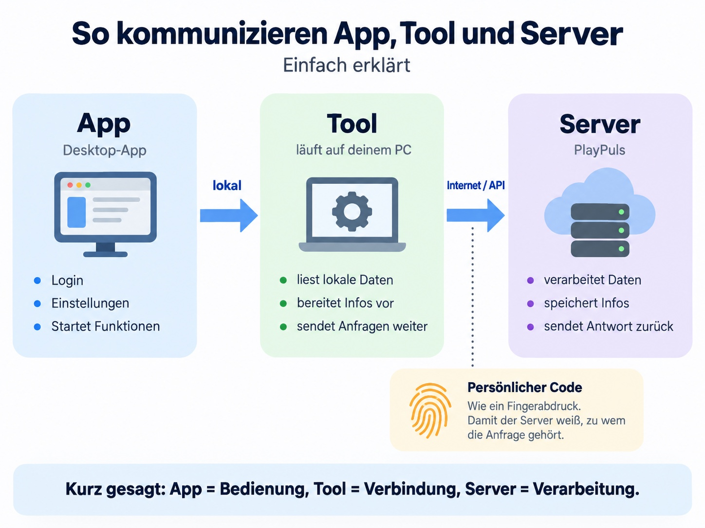

# PlayPuls – LS25 Tool

Die PlayPuls-App für **Windows 64-Bit (x64)** verbindet deinen PC und die PlayPuls-Mod für Landwirtschafts-Simulator 25 mit deiner PlayPuls-Community. Eine 32-Bit-Ausgabe wird nicht angeboten.

**Aktuelle Version: 1.0.0.** Das Setup und das
Portable-Paket enthalten die PlayPuls-Mod 0.0.0.7 und die vollständige
Versionshistorie als `readme.html` und `readme.txt`. Die HTML-Übersicht
ist am Ende der Installation und unter **Info & Hilfe → Version** erreichbar.

[Programm, Bilder und FAQ](https://play-puls.de/ls-tool) · [Öffentlich verfügbare Version](https://github.com/Jan204/PlayPuls-Updates/releases/latest) · [Installationsanleitung für 1.0.0](INSTALLATION.md)

## So funktioniert die Verbindung

Für Online-Funktionen arbeiten App und Mod zusammen. Die Mod kann Aufgaben, Handel und den lokalen Fuhrpark auch offline ohne App und ohne Code verwenden. Offline-Planungen bleiben lokal, bis du sie nach einer späteren Verbindung ausdrücklich zur Übertragung bestätigst.

## Neu in 1.0.0

Die Windows-App erhält eine neue Navigation und eine Serverübersicht,
die den letzten gespeicherten Stand sofort anzeigen kann. Das Farbschema
folgt standardmäßig Windows. Hell und Dunkel lassen sich fest wählen.
Der Hofbestand zeigt Felder, Grundstücke, Tiere, Produktionen und sonstige
Anlagen auch ohne laufendes Spiel. Ein Rechtsklick öffnet die verfügbaren
Erstellaktionen. Der ModHub lädt im lokalen Spielmodus bei geöffneter App
die öffentliche Liste. Der 1:1-Modabgleich zeigt anstehende Änderungen vor
dem ersten Abgleich zur Bestätigung an. [Patchnotes 1.0.0](PATCHNOTES_1.0.0.md)

## Versionshistorie

- [1.0.0](PATCHNOTES_1.0.0.md)
- [0.0.0.8 · Teststand](PATCHNOTES_0.0.0.8.md)
- [0.0.0.7](PATCHNOTES_0.0.0.7.md)
- [0.0.0.6](PATCHNOTES_0.0.0.6.md)
- [0.0.0.5](PATCHNOTES_0.0.0.5.md)
- [0.0.0.4](PATCHNOTES_0.0.0.4.md)
- [0.0.0.3](PATCHNOTES_0.0.0.3.md)
- [0.0.0.2](PATCHNOTES_0.0.0.2.md)

## Was bietet das Tool?

- **Übersicht:** Aufgaben offen/gesamt, Handel offen/gesamt/deine offenen Angebote und die Fuhrparkanzahl für den ausgewählten Bereich/Hof. Mausover erklärt die Kennzahlen.
- **Ingame-Mod:** Aufgaben und Handelsaufträge direkt im Spiel erstellen und verwalten, lokalen Fuhrpark anzeigen; Offline-Planung ohne geöffnete App und ohne Code.
- **Serververwaltung:** Berechtigte Server starten und stoppen, Passwörter verdeckt anzeigen und kopieren sowie den Modordner auf Wunsch alle drei Minuten mit dem Server spiegeln.
- **Aufgabenverwaltung:** Aufgaben mit Ziel, Beschreibung, Früchten, Planung und Arbeitsschritten in der App bearbeiten. Aktivierte Monatsreminder erinnern an den passenden Spielmonat.
- **Handel:** Handelsaufträge und Lieferungen mit Artikeln, Mengen, Einheiten, Preisen und Fristen verwalten.
- **Fuhrpark:** Mehrere Fahrzeuge und Geräte mit gemeldeten Füllmengen und Einheiten übersichtlich als Tabelle anzeigen.
- **Höfe:** Spielhöfe mit berechtigten PlayPuls-Höfen verknüpfen und die Hofzuordnung in App oder Ingame-Einstellungen verwalten.
- **Stammdaten:** Felder, Früchte, Grundstücke und eigene Produktionen manuell aus dem Spiel ergänzen. Eigene Stammdaten weiterhin im Web anlegen und bearbeiten.
- **Modordner:** Eigene Ordnerprofile für verschiedene Server oder Maps auswählen und den passenden Modordner aktivieren.
- **Logauswertung:** Die LS25-Logdatei einlesen, Warnungen und Fehler suchen, filtern und exportieren.

Welche Daten und Aktionen verfügbar sind, hängt von deiner Discord-Community, deinem LS-Rang, deinen Hofrechten und dem Abo der Community ab. Die App zeigt diese Zuordnung oben an.

## Download und Installation

Der Installer und das Portable-Paket für 1.0.0 setzen Windows mit 64 Bit voraus. Für das Portable-Paket den gesamten Inhalt entpacken und anschließend `PlayPuls.exe` öffnen. Die öffentlich verfügbaren Pakete stehen bei den [Downloads](https://github.com/Jan204/PlayPuls-Updates/releases/latest).

[Zur Installation und Einrichtung der veröffentlichten Version](https://github.com/Jan204/PlayPuls-Updates/blob/main/INSTALLATION.md)

**1:1-Sync:** Bei unterschiedlichen Versionen zwischen Lokal und Server fragt die App nach. „Lokal behalten“ fragt zusätzlich, ob die Mod auch auf den Server hochgeladen werden soll; ohne Zustimmung bleibt die Server-Version bestehen. Die lokale Auswahl wird für dieses Versionspaar gemerkt. Zusätzliche lokale Mod-ZIPs werden weiterhin gelöscht. Andere Dateien und Unterordner bleiben bestehen. Eigene Modänderungen vorher außerhalb des Modordners sichern. Während LS25 läuft, wartet der automatische Download; manuelle Mod-Downloads bleiben ergänzend. Bei Übertragungsfehlern erscheint ein Fehlerfenster; die Automatik pausiert bis zum Fortsetzen über Sync.

## Häufige Fragen

### Muss PlayPuls während des Spiels geöffnet bleiben?

Für Online-Funktionen ja: Die App stellt die Verbindung zwischen Mod, PC und PlayPuls bereit. Im Offline-Modus funktionieren lokale Aufgaben, Handelsplanung und Fuhrpark direkt in der Mod ohne App. Es werden dabei keine Moddaten zur Webseite übertragen.

### Brauche ich bei jedem Start einen neuen Code?

Nein. Die bestätigte Spielverbindung bleibt geschützt auf deinem PC gespeichert. Solange sie gültig und berechtigt ist, wird sie bei weiteren Starts wieder verwendet. Nach Trennen, Ablauf oder Widerruf ist eine neue Verbindung erforderlich.

### Kann ich für verschiedene Server unterschiedliche Mods nutzen?

Ja. Unter **Tools → Modordner** kannst du mehrere benannte Ordnerprofile speichern und aktivieren. LS25 lädt nur den aktiven Modordner. Schließe das Spiel, bevor du den Ordner wechselst oder das Modpaket ersetzt.

### Werden meine Logs automatisch hochgeladen?

Die Logansicht liest Dateien nur auf deine Aktion hin lokal ein. Die Originaldatei wird dabei nicht verändert. Warnungen und Fehler kannst du selbst exportieren.

### Wie funktionieren PlayPuls-Modupdates?

Ab App 0.0.0.6 wird der getrennte, signierte Modkanal beim Start und anschließend alle sechs Stunden geprüft. In Einstellungen → Mod & Updates lassen sich Modupdates auch manuell prüfen und herunterladen. Ein kompatibles Modupdate benötigt kein Toolupdate. Das Einfügen in einen Modordner muss bestätigt werden; LS25 muss geschlossen sein. Host und Mitspieler brauchen dieselbe ZIP. Bei unterschiedlichen lokalen und Server-Versionen fragt der automatische Modabgleich nach deiner Auswahl.

### Wie funktionieren Toolupdates?

Öffne **Einstellungen → Updates prüfen**. Ein verfügbares Update wird im Programm heruntergeladen und vor der Installation geprüft. Dafür muss ein veröffentlichtes Paket mit digital signierten Updateinformationen vorliegen. Der Updater prüft die Signatur sowie Dateigröße und SHA-256 des Installers. Prüfsummen allein ersetzen keine Signatur. Änderungen mit derselben Versionsnummer lösen kein Versionsupdate aus. Während LS25 läuft, wird kein Toolupdate installiert.

Nach dem geprüften Download wählst du „Jetzt neu starten“ oder „Später neu starten“. Auch automatisch heruntergeladene Updates warten auf diese Bestätigung. Wer den gleichnamigen 1.0.0-Teststand nutzt, installiert das freigegebene Setup manuell.

### Kann ich ohne Verbindung alle gespeicherten Daten verwenden?

Private Online-Daten aus dem App-Cache erfordern weiterhin eine aktuelle Rechteprüfung. Davon getrennt speichert die Mod eigene Offline-Aufgaben und Handelsaufträge lokal je Spielstand und Spielhof. Nach einer späteren Verbindung werden nur ausdrücklich bestätigte offene Planungen übertragen; Geld, Lieferungen und erledigte Arbeitsschritte werden nicht nachgebucht. Lokale Planungen werden nicht zwischen Mitspielern verteilt.

## PlayPuls und GamePuls

- [PlayPuls](https://play-puls.de): Discord-Bot und Webverwaltung für deine Community, LS-Server, Höfe, Aufgaben und Handel.
- [GamePuls](https://dein-gamepuls.de): Gaming-News, Guides und Tests rund ums Gaming.

## Hilfe

### VirusTotal zu PlayPuls 1.0.0

Beim Installer meldet 1 von 67 Engines mit Ergebnis einen Verdacht.
[VirusTotal-Prüfbericht für PlayPuls 1.0.0 – Installer](https://www.virustotal.com/gui/file/194369e40a09e4c8862382349f607db6b882121a358b5191c6d513d90cd4b1af)

Bei der Programmdatei melden 3 von 68 Engines mit Ergebnis einen Verdacht.
[VirusTotal-Prüfbericht für PlayPuls 1.0.0 – Programmdatei](https://www.virustotal.com/gui/file/301f3726d092c43b70e5f800f22b2a307ab89a416fc60c21cdd1357bb29f8825)

Die Einstufung als Fehlalarm bleibt offen.
[Fundnamen, Prüfsummen und Prüfungen ohne Ergebnis](VIRUSTOTAL_1.0.0.md#releasekandidat-mit-html-versionsübersicht)

### Frühere VirusTotal-Berichte zum Windows-Standard-Testbuild 1.0.0

1 von 65 Engines mit Ergebnis meldet einen Verdacht.
[VirusTotal-Prüfbericht für PlayPuls 1.0.0 – Installer](https://www.virustotal.com/gui/file/798673b42dc4188a8570bc975813377cddc6aaea0fb5d7b8156dba5c09fce6c2)

3 von 68 Engines mit Ergebnis melden einen Verdacht.
[VirusTotal-Prüfbericht für PlayPuls 1.0.0 – Programmdatei](https://www.virustotal.com/gui/file/c62b8cc8d7e8b9d2e49e38a436bb500005ae30c0a576345d44a6fa81814b80a8)

Die Befunde sind offen. [Fundnamen, Prüfsummen und Prüfungen ohne Ergebnis](VIRUSTOTAL_1.0.0.md)

### Prüfstatus zu 0.0.0.7

[Dokumentierter Prüfstatus](VIRUSTOTAL_0.0.0.7.md).

### Frühere VirusTotal-Berichte zu 0.0.0.6

[VirusTotal-Prüfbericht für PlayPuls 0.0.0.6 – Installer](https://www.virustotal.com/gui/file/57c2040962a06650008cb8e21a28f18ad6b45d4d364db37a2b5d1c0ec5409663) – 1 von 70 Engines meldet einen Verdacht.

[VirusTotal-Prüfbericht für PlayPuls 0.0.0.6 – Programmdatei](https://www.virustotal.com/gui/file/5d5da299f6836f08d858cd611f33b3a3e5247fb88c6ac95d0028b9657bdf94d6) – 4 von 71 Engines melden einen Verdacht.

[VirusTotal-Prüfbericht für PlayPuls 0.0.0.6 – Portable-Paket](https://www.virustotal.com/gui/file/6ca66a4305d06e6d22da467385da9c47edf640e4bacf83a108f42e4cbf4964cf) – Keine Erkennung bei 67 Engines.

Die Verdachtsmeldungen sind nicht als Fehlalarme bestätigt. [Befunde, Datenzugriffe und Lizenzhinweis](https://github.com/Jan204/PlayPuls-Updates/blob/main/VIRUSTOTAL_0.0.0.6.md).

Installer und Programmdatei haben keine Windows-Herausgebersignatur. SmartScreen bewertet Signatur und Reputation; eine Nutzungslizenz ersetzt diese Prüfung nicht.

Hilfe bekommst du im [Discord](https://discord.gg/uMnajk3Fnp) oder über das [Kontaktformular](https://dein-gamepuls.de/kontakt-gamepuls/).
Du kannst auch auf [PlayPuls](https://play-puls.de) **Support** öffnen und ein Ticket erstellen.
