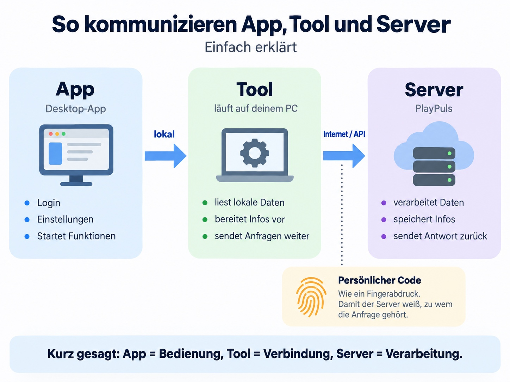

# PlayPuls – LS25 Tool

Die PlayPuls-App für **Windows 64-Bit (x64)** verbindet deinen PC und die PlayPuls-Mod für Landwirtschafts-Simulator 25 mit deiner PlayPuls-Community. Eine 32-Bit-Ausgabe wird nicht angeboten.

**Veröffentlicht: Version 0.0.0.4.** Installer, Portable-Paket, passende LS25-Mod und readme.txt findest du im [öffentlichen Release](https://github.com/Jan204/PlayPuls-Updates/releases/tag/v0.0.0.4).

[Programm, Bilder und FAQ](https://play-puls.de/ls-tool) · [Downloads](https://github.com/Jan204/PlayPuls-Updates/releases/latest) · [Installationsanleitung](https://github.com/Jan204/PlayPuls-Updates/blob/main/INSTALLATION.md) · [Patchnotes und Hilfe als Textdatei](https://github.com/Jan204/PlayPuls-Updates/releases/download/v0.0.0.4/readme.txt)

## So funktioniert die Verbindung

Für Online-Funktionen arbeiten App und Mod zusammen. Die Mod kann Aufgaben, Handel und den lokalen Fuhrpark auch offline ohne App und ohne Code verwenden. Offline-Planungen bleiben lokal, bis du sie nach einer späteren Verbindung ausdrücklich zur Übertragung bestätigst.

## Was bietet das Tool?

- **Übersicht:** Aufgaben offen/gesamt, Handel offen/gesamt/deine offenen Angebote und die Fuhrparkanzahl für den ausgewählten Bereich/Hof. Mausover erklärt die Kennzahlen.
- **Ingame-Mod:** Aufgaben und Handelsaufträge direkt im Spiel erstellen und verwalten, lokalen Fuhrpark anzeigen; Offline-Planung ohne geöffnete App und ohne Code.
- **Serververwaltung:** Berechtigte Server starten und stoppen, Passwörter verdeckt anzeigen und kopieren sowie den Modordner auf Wunsch alle drei Minuten mit dem Server spiegeln.
- **Aufgabenverwaltung:** Aufgaben mit Ziel, Beschreibung, Früchten, Planung und Arbeitsschritten in der App bearbeiten. Aktivierte Monatsreminder erinnern an den passenden Spielmonat.
- **Handel:** Handelsaufträge und Lieferungen mit Artikeln, Mengen, Einheiten, Preisen und Fristen verwalten.
- **Fuhrpark:** Mehrere Fahrzeuge und Geräte mit gemeldeten Füllmengen und Einheiten übersichtlich als Tabelle anzeigen.
- **Höfe:** Spielhöfe mit berechtigten PlayPuls-Höfen verknüpfen und die Hofzuordnung in App oder Ingame-Einstellungen verwalten.
- **Stammdaten:** Felder, Früchte, Grundstücke und eigene Produktionen manuell aus dem Spiel ergänzen. Eigene Stammdaten weiterhin im Web anlegen und bearbeiten.
- **Modordner:** Eigene Ordnerprofile für verschiedene Server oder Maps auswählen und den passenden Modordner aktivieren.
- **Logauswertung:** Die LS25-Logdatei einlesen, Warnungen und Fehler suchen, filtern und exportieren.

Welche Daten und Aktionen verfügbar sind, hängt von deiner Discord-Community, deinem LS-Rang, deinen Hofrechten und dem Abo der Community ab. Die App zeigt diese Zuordnung oben an.

## Download und Installation

Für Windows mit 64 Bit. Im veröffentlichten Release 0.0.0.4 stehen der `.exe`-Installer, das Portable-`.zip` sowie die passende LS25-Mod bereit. Jede Download-Datei und `update.json` erhalten eine eigene `.sha256`-Prüfsummendatei. Für das Portable-Paket den gesamten Inhalt entpacken und anschließend `PlayPuls.exe` öffnen.

[Zur Installation und Einrichtung der veröffentlichten Version](https://github.com/Jan204/PlayPuls-Updates/blob/main/INSTALLATION.md)

**1:1-Sync:** Wenn du ihn aktivierst, hat der Serverstand Vorrang. Abweichende lokale Mod-ZIPs werden ersetzt und zusätzliche lokale Mod-ZIPs gelöscht. Andere Dateien und Unterordner bleiben bestehen. Eigene Modänderungen vorher außerhalb des Modordners sichern. Während LS25 läuft, wartet der automatische Download; manuelle Mod-Downloads bleiben ergänzend.

## Häufige Fragen

### Muss PlayPuls während des Spiels geöffnet bleiben?

Für Online-Funktionen ja: Die App stellt die Verbindung zwischen Mod, PC und PlayPuls bereit. Im Offline-Modus funktionieren lokale Aufgaben, Handelsplanung und Fuhrpark direkt in der Mod ohne App. Es werden dabei keine Moddaten zur Webseite übertragen.

### Brauche ich bei jedem Start einen neuen Code?

Nein. Die bestätigte Spielverbindung bleibt geschützt auf deinem PC gespeichert. Solange sie gültig und berechtigt ist, wird sie bei weiteren Starts wieder verwendet. Nach Trennen, Ablauf oder Widerruf ist eine neue Verbindung erforderlich.

### Kann ich für verschiedene Server unterschiedliche Mods nutzen?

Ja. Unter **Tools → Modordner** kannst du mehrere benannte Ordnerprofile speichern und aktivieren. LS25 lädt nur den aktiven Modordner. Schließe das Spiel, bevor du den Ordner wechselst oder das Modpaket ersetzt.

### Werden meine Logs automatisch hochgeladen?

Die Logansicht liest Dateien nur auf deine Aktion hin lokal ein. Die Originaldatei wird dabei nicht verändert. Warnungen und Fehler kannst du selbst exportieren.

### Wie funktionieren Updates?

Öffne **Einstellungen → Updates prüfen**. Ein verfügbares Update wird im Programm heruntergeladen und vor der Installation geprüft. Dafür muss ein veröffentlichtes Paket mit digital signierten Updateinformationen vorliegen. Der Updater prüft die Signatur sowie Dateigröße und SHA-256 des Installers. Prüfsummen allein ersetzen keine Signatur. Änderungen mit derselben Versionsnummer lösen kein Versionsupdate aus. Während LS25 läuft, wird kein Toolupdate installiert.

Nach dem geprüften Download wählst du „Jetzt neu starten“ oder „Später neu starten“. Auch automatisch heruntergeladene Updates warten auf diese Bestätigung. Wer bereits das lokale Testpaket 0.0.0.4 nutzt, installiert den öffentlichen Installer manuell, da dieselbe Versionsnummer keinen Updatehinweis auslöst.

### Kann ich ohne Verbindung alle gespeicherten Daten verwenden?

Private Online-Daten aus dem App-Cache erfordern weiterhin eine aktuelle Rechteprüfung. Davon getrennt speichert die Mod eigene Offline-Aufgaben und Handelsaufträge lokal je Spielstand und Spielhof. Nach einer späteren Verbindung werden nur ausdrücklich bestätigte offene Planungen übertragen; Geld, Lieferungen und erledigte Arbeitsschritte werden nicht nachgebucht. Lokale Planungen werden nicht zwischen Mitspielern verteilt.

## PlayPuls und GamePuls

- [PlayPuls](https://play-puls.de): Discord-Bot und Webverwaltung für deine Community, LS-Server, Höfe, Aufgaben und Handel.
- [GamePuls](https://dein-gamepuls.de): Gaming-News, Guides und Tests rund ums Gaming.

## Hilfe

### VirusTotal und Windows-Hinweis zu 0.0.0.4

[VirusTotal-Prüfbericht für PlayPuls 0.0.0.4 – Installer](https://www.virustotal.com/gui/file/c7997e2571d94055abf5732875042fe1f22ce3b45fe91df884f92fd0c7f7d274) – 2 von 69 Engines melden einen Verdacht.

[VirusTotal-Prüfbericht für PlayPuls 0.0.0.4 – Programmdatei](https://www.virustotal.com/gui/file/de35bff8f191f23051ccc13c70432627b034b6761707a6555fe1374df08ddcb6) – 5 von 70 Engines melden einen Verdacht.

Die Funde sind nicht als Fehlalarme bestätigt. Eine mögliche Erklärung sind
heuristische Erkennungen des mit PyInstaller gebündelten Programms; daraus
folgt keine Sicherheitsgarantie. Beide Dateien sind außerdem ohne Windows-
Herausgebersignatur. Die SmartScreen-Meldung betrifft Signatur/Reputation,
nicht die Nutzungslizenz. [Prüfgrund, Befunde, Datenzugriffe und Lizenzhinweis](VIRUSTOTAL_0.0.0.4.md).

Hilfe bekommst du im [Discord](https://discord.gg/uMnajk3Fnp) oder über das [Kontaktformular](https://dein-gamepuls.de/kontakt-gamepuls/).
Du kannst auch auf [PlayPuls](https://play-puls.de) **Support** öffnen und ein Ticket erstellen.
